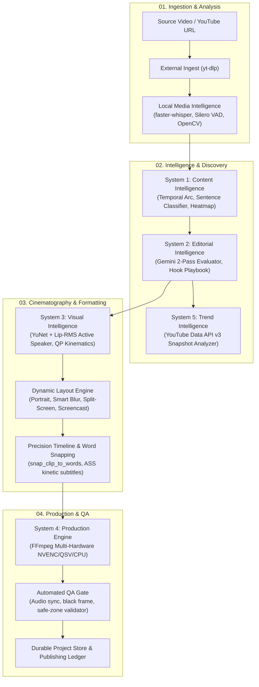

# Platform Architecture & Component Map
## Project Dominance: AI Video Intelligence & Automated Repurposing Platform

---

## 1. System Overview

The platform operates as five coordinated, modular intelligence engines:

---

## 2. The 5 Coordinated Systems

### SYSTEM 1: Content Intelligence
- **Role:** Understands long-form narrative structure, detects conversational arcs, dialogue density, and local engagement signals without external paid APIs.
- **Key Modules:**
  - `src/yt_clipping/detection/arc_detector.py`: Scans narrative arcs (Hook, Context, Escalation, Payoff).
  - `src/yt_clipping/detection/sentence_classifier.py`: Syntactic classification for hook triggers, bold claims, and questions.
  - `src/yt_clipping/detection/solid_shorts.py`: Mathematical yield decision engine balancing duration vs non-cannibalizing clips.
  - `src/yt_clipping/discovery/heatmap.py`: Extracts and normalizes public YouTube replay heatmap peaks.

### SYSTEM 2: Editorial Intelligence (Gemini 2-Pass)
- **Role:** Deep contextual evaluation using Gemini 1.5/2.5 Flash within free-tier quotas.
- **Key Modules:**
  - `src/yt_clipping/scoring/gemini_service.py`: Centralized rate-limited API gateway with header-only auth and exponential backoff.
  - `src/yt_clipping/scoring/gemini_provider.py`: Two-pass evaluator (Pass 1: 2-Second Test window scoring; Pass 2: Detail extraction with Hook Playbook & 8 Virality Signals).
  - `src/yt_clipping/scoring/scorecard.py`: Multi-signal explainable scorecard fusing local arcs with LLM rationale.
  - `src/yt_clipping/analytics/feedback_loop.py`: Empirical feedback calibration loop applying historical view/completion multipliers.

### SYSTEM 3: Visual Intelligence & Cinematography
- **Role:** Automated framing, face detection, active speaker tracking, and smooth camera trajectories using local computer vision.
- **Key Modules:**
  - `src/yt_clipping/rendering/face_tracker.py`: High-framerate face detection (YuNet ONNX + Haar Cascade) with micro-artifact suppression.
  - `src/yt_clipping/rendering/trajectory.py`: AutoFlip-inspired 1D constrained kinematic quadratic programming optimizer (`solveh_banded`).
  - `src/yt_clipping/rendering/active_speaker.py`: Lip-motion optical variance gated by audio RMS energy.
  - `src/yt_clipping/supoclip/reframer.py`: Multi-layout dynamic reframing (Active Speaker, Ambient Flowing Blur, Face-Centered Split-Screen).

### SYSTEM 4: Production & Rendering Engine
- **Role:** High-performance video transcode, kinetic typography, audio polish, and independent quality assurance.
- **Key Modules:**
  - `src/yt_clipping/rendering/renderer.py`: FFmpeg filtergraph construction with atomic output promotion.
  - `src/yt_clipping/rendering/encoder_config.py`: Hardware encoder detection (NVIDIA NVENC, Intel QSV, AMD AMF, CPU libx264).
  - `src/yt_clipping/rendering/captions.py`: ASS subtitle generation with word-level karaoke, contrast-aware pill boxes, and split-seam anchoring (`\an5`).
  - `src/yt_clipping/utils/timeline.py`: Canonical timeline representation and `snap_clip_to_words()` boundary alignment.
  - `src/yt_clipping/qa/verifier.py`: 12-point post-render quality gate (decodability, aspect ratio, audio stream, duration integrity).

### SYSTEM 5: Trend Intelligence
- **Role:** YouTube Data API v3 integration for market discovery and content opportunity suggestions.
- **Key Modules:**
  - `src/yt_clipping/discovery/trend_analyzer.py`: Quota-aware YouTube Data API v3 collector (`videos.list` chart queries).
  - `src/yt_clipping/discovery/trend_scorer.py`: Topic clustering, recurrence tracking, and historical velocity calculations.
  - `src/yt_clipping/discovery/quota_governor.py`: Daily quota safety governor preventing API exhaustion.

---

## 3. Strict Non-Negotiable Resource Constraints

1. **Permitted External APIs (Strictly 2):**
   - `GEMINI_API_KEY`: For contextual highlight discovery, title generation, and packaging.
   - `YOUTUBE_DATA_API_KEY`: For public trend charts and video metadata retrieval.
2. **Prohibited Dependencies:** Zero paid commercial APIs (No ElevenLabs, No OpenAI, No MuAPI, No Anthropic, No paid transcription services).
3. **Execution Environment:** 100% local-first on standard Windows / Linux workstations with CPU fallback for systems without dedicated NVIDIA GPUs.
