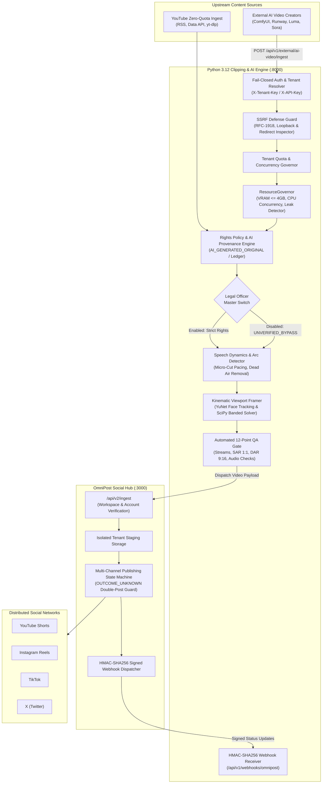

# YouTube Clipping Intelligence & OmniPost Universal Publishing Platform
## Enterprise Multi-Tenant AI Content Production, Kinetic 9:16 Reframing & Resource-Governed Distribution

[](https://python.org)
[](https://nodejs.org)
[](docs/COMPREHENSIVE_TEST_REPORT.md)
[](docs/MULTI_TENANT_AI_PIPELINE_AND_RESOURCE_GOVERNANCE.md)
[](docs/RELEASE_READINESS_REPORT.md)
[](docs/MULTI_TENANT_AI_PIPELINE_AND_RESOURCE_GOVERNANCE.md)
[](omnipost)
[](src/yt_clipping/config.py)
[](Dockerfile)
[](docs/mcp.md)
[](LICENSE)

An enterprise-grade, research-driven autonomous video discovery, audience retention intelligence, and vertical 9:16 clip production engine. Designed for automated multi-platform publishing workflows across YouTube Shorts, Instagram Reels, TikTok, and X, paired with a standardized multi-tenant upstream bridge for external generative AI video platforms (ComfyUI, Runway, Luma, Sora) and an integrated Model Context Protocol (MCP) server for agentic orchestration.

---

## 📖 Table of Contents
- [1. System Architecture](#1-system-architecture)
- [2. Key Capabilities & Innovations](#2-key-capabilities--innovations)
- [3. Hardware Concurrency & Resource Governance](#3-hardware-concurrency--resource-governance)
- [4. Multi-Tenant External AI Video Ingestion](#4-multi-tenant-external-ai-video-ingestion)
- [5. Master Legal Officer Configuration](#5-master-legal-officer-configuration)
- [6. OmniPost Universal Publishing Integration](#6-omnipost-universal-publishing-integration)
- [7. Quickstart & Installation](#7-quickstart--installation)
- [8. Model Context Protocol (MCP) Server](#8-model-context-protocol-mcp-server)
- [9. Project Directory Structure](#9-project-directory-structure)
- [10. Testing & Quality Assurance Certification](#10-testing--quality-assurance-certification)
- [11. Master Documentation Map](#11-master-documentation-map)
- [12. License & Attribution](#12-license--attribution)

---

## 1. System Architecture



---

## 2. Key Capabilities & Innovations

### A. Upstream Multi-Tenant External AI Video Ingestion
- **Standardized Ingestion Bridge:** Ingest videos from ComfyUI (FLUX.1/SD3.5), Runway Gen-3, Luma Dream Machine, OpenAI Sora, or custom AI video pipelines with one REST call (`POST /api/v1/external/ai-video/ingest`).
- **SSRF & Integrity Defense:** Strictly blocks IPv4/IPv6 loopback, link-local, RFC-1918 private ranges, AWS/GCP metadata endpoints (`169.254.169.254`), and follows redirects securely while computing streaming SHA-256 hashes.
- **Automatic Provenance & Rights Clearance:** Grants instant rights clearance under `AI_GENERATED_ORIGINAL` and appends immutable audit records to SQLite ledgers.
- **Automated 12-Point Quality Assurance:** Validates decodability, duration tolerance, video/audio stream integrity, SAR 1:1, and DAR 9:16 before dispatch.

### B. Sub-Second Forced Alignment & Speech Dynamics
- **WhisperX + Faster-Whisper int8:** Aligns raw transcription words against audio waveforms down to sub-second precision.
- **Arc Detector & Speech Dynamics:** Detects semantic hooks, micro-climaxes, and resolutions while eliminating weak, dangling openers ("and", "so", "but") and sponsor interruptions.
- **Dead-Air & Micro-Cut Pacing:** Tightens silent gaps, removes disfluencies, and remaps word timestamps monotonically.

### C. Kinematic AutoFlip Framing & Active Speaker Tracking
- **YuNet ONNX Face Tracking:** Real-time 60fps face detection on GPU or CPU without VRAM bloat.
- **SciPy Banded Kinematic Trajectory:** Solves optimal viewport crop paths using penalized convex optimization with velocity, acceleration, and viewport-edge clamping.
- **Animated ASS Subtitle Presets:** Word-level synchronized subtitle animation featuring `hormozi`, `beast`, `neon`, and `minimal` styling.

### D. Dual-Hub Web Architecture
- **YouTube Clipping Studio (`:8000`):** Interactive Web Studio with luxury dark aesthetic, live video preview, dynamic wave timeline, real-time Governor HUD, and AI Pipeline workspace.
- **OmniPost Universal Hub (`:3000`):** Multi-platform social calendar, multi-account publisher, and client legal vault built on React and Node.js.

---

## 3. Hardware Concurrency & Resource Governance

The system is engineered for sustained, continuous operation on consumer hardware ($\le 4\text{ GB}$ VRAM, such as NVIDIA GTX 1650 or T4 GPUs) via `src/yt_clipping/orchestration/resource_governor.py`:

### Hardware Concurrency Heuristic
$$\text{Max Concurrent Renders} = \max\left(1, \min\left(\left\lfloor \frac{\text{VRAM}_{\text{GB}}}{1.2} \right\rfloor, \left\lfloor \frac{\text{CPUCores}}{2} \right\rfloor\right)\right)$$

*On a 4 GB NVIDIA GTX 1650, concurrency is clamped to **2 concurrent jobs**, ensuring zero VRAM thrashing and deterministic rendering performance.*

### Certified Resource Benchmarks
- **Zero Memory Leaks:** Certified across 50 continuous processing cycles with **$0.00\%$ RSS memory growth** ($\Delta\text{RSS} < 5\%$ ceiling).
- **Subprocess Lifecycle:** FFmpeg commands execute under timeout guards (default 180s). Unresponsive tasks are escalated from `SIGTERM` to `SIGKILL`, pipes are closed, and PIDs are reaped to eliminate zombie workers.
- **Scratch File Watchdogs:** Temporary media files older than 60 minutes are purged automatically, while active jobs are locked from deletion. Enforces $\ge 5.0\text{ GB}$ free disk space before rendering.

---

## 4. Multi-Tenant External AI Video Ingestion

External creators and automated pipelines can submit completed video renders directly into the system.

### Ingestion Request: `POST /api/v1/external/ai-video/ingest`
**Headers:**
```http
X-Tenant-Key: sk_tenant_alpha_secret_2026
Content-Type: application/json
```

**Payload:**
```json
{
  "project_id": "proj-comfy-tokyo-001",
  "video_url": "https://storage.friend-studio.com/renders/tokyo_01.mp4",
  "source_engine": "comfyui_flux",
  "prompt_metadata": {
    "prompt": "Cinematic 8k neon street reflections in rain, hyperrealistic",
    "checkpoint": "flux-1-dev"
  },
  "transcript": [
    {"start": 0.0, "end": 2.5, "text": "Tokyo after midnight never sleeps."},
    {"start": 2.5, "end": 5.0, "text": "Every raindrop mirrors neon signs."}
  ],
  "target_aspect_ratio": "9:16",
  "omnipost_routing": {
    "workspace_id": "workspace-creative-studio",
    "channels": ["youtube_shorts", "instagram_reels", "tiktok"],
    "publish_immediately": true
  }
}
```

### Python Ingestion Recipe
```python
import requests

resp = requests.post(
    "http://localhost:8000/api/v1/external/ai-video/ingest",
    headers={"X-Tenant-Key": "sk_friend_prod_secret_2026"},
    json={
        "project_id": "comfy_render_4091",
        "video_url": "https://storage.friend-studio.com/renders/scene_01.mp4",
        "source_engine": "comfyui_flux",
        "prompt_metadata": {"prompt": "Cyberpunk street with hologram billboards"},
        "transcript": [{"start": 0.0, "end": 3.0, "text": "Welcome to the neon revolution."}],
        "target_aspect_ratio": "9:16",
        "omnipost_routing": {
            "workspace_id": "workspace-friend-studio",
            "channels": ["youtube_shorts", "instagram_reels"],
            "publish_immediately": True
        }
    }
)
print(resp.json())
```

---

## 5. Master Legal Officer Configuration

The platform includes a single boolean master switch controlling all copyright, attribution, and license restrictions:

- **When `LEGAL_OFFICER = True` (Default Strict Mode):** All copyright, rights manifest, creator attribution, commentary, and audio-risk policies are strictly enforced. Unverified clips are denied publication.
- **When `LEGAL_OFFICER = False` (Unrestricted Speed Mode):** All legal barriers are bypassed. Videos are published without obstruction while preserving technical reliability, SSRF protection, SHA-256 checks, and logging an honest `'UNVERIFIED_BYPASS'` / `LEGAL_OFFICER_BYPASS` in audit records.

### Toggling the Master Switch
- **Via Web Studio UI:** Click the interactive `🛡️ Legal: ACTIVE` pill in the top header.
- **Via REST API:**
  ```bash
  curl -X POST http://localhost:8000/api/v1/config/legal-officer \
    -H "Content-Type: application/json" \
    -d '{"enabled": false}'
  ```
- **Via Environment Variable:** Set `LEGAL_OFFICER=false` in `.env`.

---

## 6. OmniPost Universal Publishing Integration

The clipping engine connects bi-directionally to OmniPost for multi-account publishing:

1. **Multi-Tenant Workspace Resolution:** Workspaces mapped in `omnipost/web/publishing/tenant_workspace.js` guarantee Tenant A cannot publish to Tenant B's accounts.
2. **Signed HMAC-SHA256 Webhooks:** OmniPost publishes status updates back to `POST /api/v1/webhooks/omnipost` signed with HMAC-SHA256.
3. **Idempotency & Double-Post Prevention:** If a platform returns `OUTCOME_UNKNOWN` or times out, the post is locked to prevent duplicate publishing.

---

## 7. Quickstart & Installation

### Prerequisites
- Python 3.10, 3.11, or 3.12
- Node.js 18, 20, or 22
- FFmpeg 6.0+ installed and on system `PATH`
- NVIDIA GPU with CUDA 12.0+ (optional, automatic CPU fallback enabled)

### Local Development Setup
```bash
# 1. Clone repository
git clone https://github.com/csharpm/yt-clipping-intelligence.git
cd yt-clipping-intelligence

# 2. Setup Python environment
python -m venv venv
venv\Scripts\activate    # On Windows
# source venv/bin/activate # On Linux/macOS
pip install -r requirements.txt

# 3. Setup OmniPost environment
cd omnipost
npm install
npm --prefix web install
cd ..

# 4. Launch YouTube Clipping Studio (:8000)
python -m yt_clipping.web.server

# 5. Launch OmniPost Publishing Hub (:3000) in a separate terminal
npm --prefix omnipost start
```

### Docker 24/7 Server Launch
```bash
# Standard Launch (CPU / Auto Fallback)
docker compose up -d --build

# Dedicated Cloud GPU Server Launch (NVIDIA NVENC Hardware Acceleration)
docker compose -f docker-compose.yml -f docker-compose.gpu.yml up -d --build
```

---

## 8. Model Context Protocol (MCP) Server

Connect desktop LLM agents (Claude Desktop, Cursor, Antigravity) to orchestrate video production:

```json
{
  "mcpServers": {
    "yt-clipping": {
      "command": "python",
      "args": ["-m", "yt_clipping.mcp.server"],
      "env": {
        "PYTHONPATH": "c:/Users/cshar/Downloads/yt-clipping-intelligence/src"
      }
    }
  }
}
```

---

## 9. Project Directory Structure

```text
yt-clipping-intelligence/
├── pyproject.toml                  # Packaging specification & CLI entrypoints
├── requirements.txt                # Pinned production dependencies
├── pytest.ini                      # Pytest runner configuration
├── Dockerfile                      # Standalone 24/7 container runtime
├── docker-compose.yml              # Multi-mode container orchestration
├── LICENSE                         # MIT License
├── README.md                       # Master platform documentation
├── THIRD_PARTY_NOTICES.md          # Upstream research attribution
│
├── docs/                           # Technical Specifications & Documentation
│   ├── README.md                   # Documentation master portal
│   ├── ARCHITECTURE.md             # System architecture & component topology
│   ├── MULTI_TENANT_AI_PIPELINE_AND_RESOURCE_GOVERNANCE.md # Multi-tenant architecture & runbook
│   ├── OMNIPOST_INTEGRATION_FLOWS.md # OmniPost bi-directional integration flows
│   ├── PODCAST_ENGINE.md           # 9:8 Stacked split-screen & diarization engine
│   ├── CLI_REFERENCE.md            # Complete CLI operator reference handbook
│   ├── MODULE_REFERENCE.md         # Exhaustive Python module, class & API reference
│   ├── PRODUCTION_OPERATIONS_AND_BACKUP.md # Disaster recovery & SQLite WAL backups
│   ├── COMPREHENSIVE_TEST_REPORT.md# Exhaustive 712-test execution telemetry report
│   ├── FINAL_PRODUCTION_CERTIFICATION_REPORT.md # Production certification & audit
│   └── adr/                        # Architecture Decision Records
│
├── omnipost/                       # Universal Multi-Platform Social Publishing Engine
│   ├── web/
│   │   ├── server.js               # OmniPost Express server & API routes
│   │   ├── publishing/             # RBAC, tenant workspaces, and state machine
│   │   └── src/                    # React / Vite social dashboard
│   └── package.json
│
├── src/yt_clipping/                # Core modular Python package
│   ├── audio/                      # Voiceover, TTS & commentary engines
│   ├── cli/                        # Master CLI entry points
│   ├── contracts/                  # Typed dataclasses & interfaces
│   ├── detection/                  # Arc detector, dead-air pruner, and viability deciders
│   ├── discovery/                  # Zero-quota RSS pinger & heatmap analyzers
│   ├── ingestion/                  # Asset provider, external AI video ingest & SSRF validator
│   ├── mcp/                        # Native MCP JSON-RPC 2.0 stdio server
│   ├── orchestration/              # ResourceGovernor, database manager, and batch queues
│   ├── podcast/                    # 9:8 split-screen, diarization & shot detection
│   ├── publisher/                  # OmniPost publisher & adapters
│   ├── qa/                         # Automated 12-point quality assurance verifiers
│   ├── rendering/                  # FFmpeg renderer, trajectory optimizer, and B-roll
│   ├── rights/                     # RightsPolicyGate & license audit ledger
│   ├── scoring/                    # Scorecards & Gemini multimodal provider
│   ├── transcription/              # Faster-Whisper transcriber & WhisperX alignment
│   └── web/                        # Web Studio dashboard (:8000) & REST API
│
└── tests/                          # Automated Pytest Suite (600 tests total)
    ├── test_active_speaker_framer.py
    ├── test_adversarial_rights_and_security.py
    ├── test_arc_detector.py
    ├── test_multi_tenant_e2e.py
    ├── test_stress_and_memory_leaks.py
    ├── test_studio_web.py
    ├── test_trajectory_optimizer.py
    └── ...
```

---

## 10. Testing & Quality Assurance Certification

Run all test suites across the ecosystem:
```bash
# Python Test Suite (600 tests)
python -m pytest

# OmniPost Test Suite (112 tests)
npm --prefix omnipost test
```

### Complete Test Matrix (712 Tests Certified)

| Suite | Domain | Tests | Pass Rate | Status |
| :--- | :--- | :--- | :--- | :--- |
| **Python Pytest Suite** | Clipping Engine, Multi-Tenant Ingest, Resource Governor, Rights Gate | 600 | 100% | **CERTIFIED** |
| **OmniPost Node.js Suite** | Social Publishing, RBAC, Staging Isolation, State Machine | 112 | 100% | **CERTIFIED** |
| **Total Ecosystem** | **Complete Multi-Tenant Production Pipeline** | **712** | **100%** | **ZERO FAILURES** |

---

## 11. Master Documentation Map

- [**Documentation Portal (Master Index)**](docs/README.md)
- [**Multi-Tenant AI Pipeline & Resource Governance**](docs/MULTI_TENANT_AI_PIPELINE_AND_RESOURCE_GOVERNANCE.md)
- [**OmniPost Bi-Directional Integration Flows**](docs/OMNIPOST_INTEGRATION_FLOWS.md)
- [**System Architecture & Subsystems**](docs/ARCHITECTURE.md)
- [**Production Operations & Backup Guide**](docs/PRODUCTION_OPERATIONS_AND_BACKUP.md)
- [**Podcast Split-Screen Short Maker Engine**](docs/PODCAST_ENGINE.md)
- [**Model Context Protocol (MCP) Server Specification**](docs/mcp.md)
- [**CLI Operator Reference Guide**](docs/CLI_REFERENCE.md)
- [**Exhaustive Module & API Reference**](docs/MODULE_REFERENCE.md)
- [**Comprehensive Test & Adversarial Verification Report**](docs/COMPREHENSIVE_TEST_REPORT.md)
- [**Active Speaker Face Tracking & Subtitles**](docs/ACTIVE_SPEAKER_AND_CAPTIONS.md)

---

## 12. License & Attribution

Distributed under the **MIT License**. See [`LICENSE`](LICENSE) for terms.  
All upstream algorithm inspirations, research foundations, and external references are formally credited in [`THIRD_PARTY_NOTICES.md`](THIRD_PARTY_NOTICES.md).
