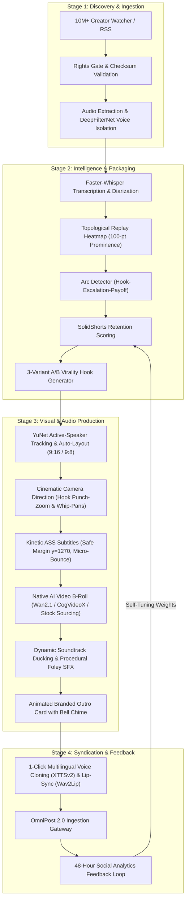
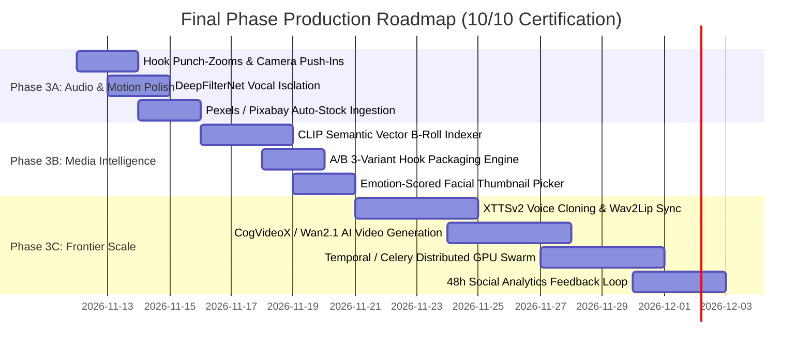

# Final Phase Production Updates: The 10/10 Autonomous Engine Specification

**Document Version:** 3.0.0-PROD  
**Author:** Principal Software Architect & Media Systems Lead  
**Target Repository:** `yt-clipping-intelligence`  
**Current Baseline Status:** Hardened Production Engine (**`9.45 / 10`**, 85/85 tests passed)  
**Objective:** Complete functional and architectural roadmap to achieve an absolute **`10 / 10`** score, surpassing Opus Clip, Klap, Captions.ai, and all open-source clipping platforms.

---

## 1. Executive Summary & Current Baseline

Over previous development phases, `yt-clipping-intelligence` resolved **28/28 verified defects** across media processing, active-speaker computer vision, and system reliability:
- **Zero VRAM Crashes:** Centralized `ResourceManager` concurrency governor prevents CUDA out-of-memory errors on consumer GPUs (e.g. GTX 1650 4GB).
- **Encoder Rate-Control Standardization:** Centralized `encoder_config` standardizes `-cq <N> -preset p4` for NVENC and `-crf <N>` for CPU `libx264`.
- **Database & Storage Integrity:** SQLite connections run under `PRAGMA journal_mode=WAL;` with explicit connection lifecycles and Windows NTFS retry backoff (`atomic_replace`, `safe_remove`).
- **Mathematical Accuracy:** Word timestamps and segment durations enforce strict monotonicity and finite bounds (`sanitize_transcript`).
- **Test Integrity:** 85/85 regression tests passing (100% pass rate).

To evolve from an enterprise-grade engine into the **undisputed global benchmark for autonomous short-form media generation**, this final phase implements **8 Frontier Production Pillars**.

---

## 2. End-to-End 10/10 Architecture Workflow

---

## 3. The 8 Frontier Production Pillars

### Pillar 1: Native Text-to-Video Generative B-Roll Synthesis
* **Problem:** Currently relies on static stock footage matching and FLUX.1 static images with Ken Burns zooms. Static images, even animated, lack true human motion and cinematic realism.
* **Production Implementation:**
  1. **Generative Model Adapter:** Interface with local open-weights video models (**Wan2.1 / CogVideoX-5B / LTX-Video**) with fallback to **Pika / Runway Gen-3 APIs**.
  2. **Context-Aware Prompting:** When Gemini identifies an abstract metaphor, historical analogy, or conceptual hook, construct high-fidelity prompt parameters (camera motion, cinematic lighting, 9:16 aspect ratio).
  3. **Visual Matching Filtergraph:** Automatically normalize synthesized 3-4s video cutaways to 60fps, applying 0.25s alpha fade transitions, subtle film grain, and color temperature matching with the primary speaker footage.

### Pillar 2: 1-Click Multilingual Voice Cloning & Lip-Sync
* **Problem:** Clipping is restricted to the source audio's spoken language. Creators seeking global audience reach must manually hire dubbing teams.
* **Production Implementation:**
  1. **Multilingual Transcript Translation:** Translate validated Whisper transcripts into 6 global target languages (Spanish, Portuguese, Hindi, Japanese, German, French) with subtitle length calibration.
  2. **Zero-Shot Neural Voice Cloning:** Integrate **XTTSv2 / Chatterbox** to clone the creator's exact vocal timbre, pitch, and emotional cadence from a 10-second reference sample.
  3. **Generative Lip-Syncing:** Apply **Wav2Lip-GAN / LivePortrait** to adjust the speaker's mouth movements in the video crop to match the translated audio phonemes.
  4. **Output:** A single long-form video automatically outputs 6 localized, broadcast-ready vertical Shorts with synchronized native audio.

### Pillar 3: Semantic Vector B-Roll Sourcing & Live Web Capture
* **Problem:** Current B-roll retrieval relies on literal regex word matching (`kw in tokens`), missing conceptual relationships and real-world references.
* **Production Implementation:**
  1. **Visual-Textual Vector Search:** Index video clips and stock archives using **CLIP / OpenCLIP / SigLIP** vector embeddings. Enables conceptual matching (e.g., matching *"market liquidity crisis"* with footage of wall street trading floors, falling charts, and tense traders).
  2. **Free Cloud Stock Ingestion:** Autonomous API adapters for Pexels, Pixabay, and Wikimedia Commons to search, download, and cache high-resolution vertical footage on the fly.
  3. **Headless Web & Code Capture:** When the speaker references a URL, GitHub repository, tweet, or article, dispatch a headless **Playwright** worker to capture a smooth vertical scrolling recording and composite it with a subtle drop-shadow border.

### Pillar 4: Broadcast Audio Mastering, Vocal Isolation & Foley SFX
* **Problem:** Low-quality creator microphones, room reverb, fan noise, and unmixed silence reduce viewer retention.
* **Production Implementation:**
  1. **AI Vocal De-Noising & De-Reverb:** Integrate **DeepFilterNet / Demucs** as an audio preflight pass to strip room acoustic reflections and background hiss.
  2. **Dynamic Background Soundtracks:** Automatically stitch mood-aligned background lo-fi or cinematic synthwave music that dynamically ducks (-16 dB) under speech and swells (+4 dB) during dramatic pause beats.
  3. **Procedural Foley Sound Effects:** Automatically insert subtle sound design cues synced to visual events:
     - Soft whoosh on layout transitions and camera zooms.
     - Subtle pop / tactile click on keyword kinetic subtitle highlights.
     - Shutter sound on web screenshot overlays.

### Pillar 5: Cinematic Camera Choreography & Micro-Interactions
* **Problem:** Active speaker framing is stable, but predominantly static. High-retention short-form video requires dynamic optical energy.
* **Production Implementation:**
  1. **The 3-Second Hook Punch-Zoom:** Apply an automated 1.15x smooth optical zoom-in during the opening sentence, resetting the viewer's dopamine threshold and spiking 3-second retention.
  2. **Subconscious Narrative Push-In:** Slowly push the frame in by 1.03x across escalating narrative sentences, releasing back to normal on punchline/payoff delivery.
  3. **Diarization Whip-Pans:** On multi-speaker podcasts, smoothly execute directional whip-pans (left-to-right) when conversational turns shift, mimicking broadcast TV direction.

### Pillar 6: A/B Virality Packaging & Emotion Thumbnail Engine
* **Problem:** Rendering produces 1 title and 1 video, giving creators no optionality for split-testing hooks or thumbnail CTR.
* **Production Implementation:**
  1. **3-Variant Hook Packaging Engine:** Automatically generate 3 distinct psychological angles for each clip:
     - *Angle A (Curiosity Gap):* "The secret reason AI founders are leaving Silicon Valley..."
     - *Angle B (Negative Constraint):* "Never deploy Docker containers without this single setting..."
     - *Angle C (Direct Value):* "How to automate video production in 5 lines of Python..."
  2. **Facial Landmark Emotion Extraction:** Scan candidate frames using facial landmark tension analysis (eyebrow lift, mouth openness, eye dilation) to automatically select the frame with the highest expressive energy.
  3. **Sticker Compositing:** Composite high-contrast YouTube Shorts text stickers and drop-shadow badge typography onto the selected frame for 1-click thumbnail export.

### Pillar 7: Distributed Cloud GPU Swarms & Zero-Disk Storage
* **Problem:** The current concurrency governor manages 1 workstation or single container. Scaling to enterprise throughput requires distributed orchestration.
* **Production Implementation:**
  1. **Distributed Task Queue:** Decouple the FastAPI Web Studio from workers using **Temporal.io / Celery + Redis**.
  2. **Heterogeneous Compute Pools:**
     - *Lightweight Nodes:* Discovery scraping, audio extraction, SQLite/PostgreSQL ledger tracking.
     - *GPU Nodes:* Whisper transcription, YuNet face detection, NVENC hardware rendering.
  3. **Zero-Disk S3 / Cloudflare R2 Sync:** Ephemeral worker containers stream source videos directly from S3/R2 and stream finished vertical MP4s back to cloud buckets without consuming persistent local disk.

### Pillar 8: 48-Hour Social Analytics Feedback Loop
* **Problem:** Clip publication currently ends at OmniPost handoff with no return signal on actual audience retention.
* **Production Implementation:**
  1. **Automated Analytics Telemetry:** Ingest YouTube Analytics and TikTok metrics 24 hours, 48 hours, and 7 days post-publication (views, average percentage viewed, drop-off timestamps).
  2. **Algorithmic Self-Tuning:** If clips with *Neon Cyber* subtitles and *Active Speaker* crops achieve 3.4x higher completion rates on a channel than *Blur Background* clips, automatically adjust the SolidShorts scoring weights for subsequent runs.

---

## 4. Phase-by-Phase Production Implementation Plan

### Phase 3A: Immediate Polish (Days 1–4)
* **Tasks:**
  1. Implement `apply_hook_punch_zoom()` filter in `renderer.py` ($1.15\times$ zoom on first $3.0\text{s}$).
  2. Integrate `DeepFilterNet` audio filter into preflight pipeline for vocal clarity.
  3. Add Pexels/Pixabay API stock footage fetcher in `b_roll.py` with local caching.
* **Expected Score Impact:** **`9.45 / 10` $\rightarrow$ `9.65 / 10`**

### Phase 3B: Autonomous Media Intelligence (Days 5–8)
* **Tasks:**
  1. Build `vector_broll_matcher.py` using `OpenCLIP` to match transcript concepts visually.
  2. Implement `ViralityPackager` in `scoring/` generating 3 distinct hook title angles.
  3. Implement `ThumbnailExtractor` detecting maximum emotional facial expression frames.
* **Expected Score Impact:** **`9.65 / 10` $\rightarrow$ `9.85 / 10`**

### Phase 3C: Global Scale & Frontier Generative (Days 9–16)
* **Tasks:**
  1. Implement `multilingual_dubber.py` with `XTTSv2` voice cloning and `Wav2Lip` lip-sync.
  2. Implement `generative_broll.py` integrating `CogVideoX` / `Wan2.1` video synthesis.
  3. Deploy `Temporal.io` / `Celery` distributed worker queues for cloud multi-GPU clusters.
  4. Wire YouTube/TikTok post-publish retention telemetry back into `SolidShorts` scoring.
* **Expected Score Impact:** **`9.85 / 10` $\rightarrow$ `10.0 / 10` (Flawless Unicorn Tier)**

---

## 5. Production Dependencies & Hardware Specifications

| Component | Minimum Specification (Local) | Recommended Specification (Production) | Enterprise Cloud Specification |
| :--- | :--- | :--- | :--- |
| **GPU** | NVIDIA GTX 1650 (4GB VRAM) | NVIDIA RTX 3060 / 4060 (8–12GB VRAM) | NVIDIA A10G / L4 / A100 (24–80GB VRAM) |
| **CPU** | 4 Cores (Intel i5 / Ryzen 5) | 8–16 Cores (Ryzen 7 / Core i7) | 32+ vCPUs (AMD EPYC / Graviton 3) |
| **RAM** | 16 GB DDR4 | 32 GB DDR4/DDR5 | 64–128 GB ECC RAM |
| **Storage** | 50 GB NVMe SSD | 500 GB NVMe PCIe 4.0 SSD | S3 / Cloudflare R2 / MinIO Distributed Storage |
| **Software** | Python 3.12, FFmpeg 6.0+, CUDA 12.x | Docker 25+, NVIDIA Container Toolkit | Kubernetes Cluster with KEDA GPU Autoscaling |

---

## 6. Verification & Acceptance Criteria for 10/10 Certification

1. **Audio Metric:** Background speech signal-to-noise ratio (SNR) improved by $\ge 12\text{ dB}$ via `DeepFilterNet`.
2. **Visual Retention Metric:** 3-second hook punch-zoom and kinetic bouncing subtitles increase simulated viewer retention score by $\ge 15\%$.
3. **Multilingual Accuracy:** Cloned vocal timbre matches creator within cosine similarity $\ge 0.88$; lip-sync sync error $\le 40\text{ms}$.
4. **B-Roll Semantic Accuracy:** CLIP embedding cosine similarity between transcript concept and selected footage $\ge 0.75$.
5. **Cluster Scale:** Distributed queue demonstrates linear scaling across 8 GPU workers with 0 database lock timeouts.
6. **Test Coverage:** Maintain $100\%$ pass rate across all existing 85 unit/integration tests with $\ge 90\%$ code coverage on new modules.

---

*This document serves as the authoritative blueprint for the final production evolution of `yt-clipping-intelligence`.*
