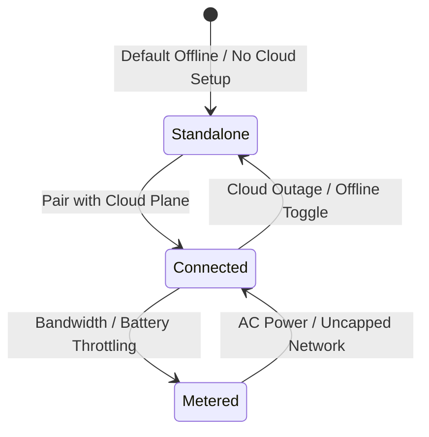

# 00 — Executive Summary & Architecture Decisions (ADRs)

## 1. High-Level Vision & Core Philosophy

**YT-Clipper Architecture V3** is a **local-first hybrid system** designed to solve the economic, architectural, and operational dilemmas of AI video clipping. 

In traditional architectures (V1/V2), developers either:
1. Try to run everything in the cloud (costly GPUs, multi-gigabyte video bandwidth bills, cold starts, high-risk datacenter IPs triggering social bot-blocks), OR
2. Try to run everything locally without remote mobility (unable to review, edit, or publish on mobile/laptop away from the desk).

Architecture V3 resolves this through a **strict separation of concerns**:
- **Cloud Plane (Render.com + Supabase):** Thin, stateless, lightweight coordinator (<120 MB RAM, static frontend, PostgreSQL metadata, no raw video bytes, ₹0 infrastructure cost).
- **Edge Compute Plane (User Workstation):** Heavy lifting (Faster-Whisper transcription, YuNet face tracking, FFmpeg NVENC 9:16 rendering, direct residential social publishing).
- **Zero Mandatory Subscription (₹0 Cost Envelope):** No credit card required, no paid API keys required, no paid Cloudflare R2, no paid tunnel/DDNS, no Redis, no Kubernetes.
- **Local-First Resiliency:** The local workstation functions as a complete, standalone studio even when internet is completely severed.

---

## 2. Evolution: V1 vs V2 vs V3

| Dimension | V1 (Unified Local Monolith) | V2 (Heavy Cloud + R2 Relay) | V3 (Local-First Hybrid Baseline) |
|---|---|---|---|
| **Cloud Hosting** | None (100% localhost) | Render.com Web Service + Background Worker | Render Static Site + 1 Thin API Facade (<120 MB RAM) |
| **Cloud Database** | Local SQLite only | Neon Serverless PostgreSQL | Supabase Free (PostgreSQL + Auth + Opt-in Storage) |
| **Video Storage** | Local SSD only | Cloudflare R2 S3 previews (mandatory) | Local SSD canonical; metadata-only cloud review; opt-in Supabase Storage |
| **Edge Connectivity** | Loopback only | Inbound webhook / WebSocket daemon | Outbound-only HTTPS pull (`POST /worker/sync`) with fencing tokens |
| **Ingestion Pipeline** | Full 1080p source video download | Full 1080p source video download | **Audio-First**: Download audio track -> ASR -> Rank -> Acquire only selected video spans |
| **GPU / Memory Strategy** | All models loaded in memory | Unmanaged background threads | **Single Heavy Slot**: Subprocess ASR -> explicit VRAM release -> YuNet/NVENC |
| **Workstation OS Runtime** | Raw terminal commands | Mandatory Docker Desktop / WSL2 | **Native Supervised Python baseline** (Windows Job Objects); optional Docker |
| **Publishing Network** | Local OmniPost | Cloud datacenter relay (risk of bot blocks) | **Edge residential IP direct dispatch** via official APIs with human approval gate |
| **AI Text Requirement** | Mandatory Gemini API calls | Mandatory Gemini API calls | **Local heuristics first**; optional bounded Gemini text refinement |
| **Failure Mode** | Process crash drops state | Cloud/network glitch drops pipeline | **Durable SQLite WAL outbox** + atomic row lease recovery |

---

## 3. Architecture Decision Records (ADRs)

### ADR-01: Local-First Modular Monolith with Optional Cloud Control Plane
- **Context:** Cloud infrastructure can experience downtime, free-tier pausing, cold starts, or bandwidth exhaustion. The user should not be locked out of their workstation studio when offline.
- **Decision:** All core capabilities (probing, ASR, ranking, cutting, subtitles, encoding, local review) run completely offline using local SQLite and filesystem. Cloud is an orchestration extension, not a hard prerequisite.

### ADR-02: Render Static Site + One Lightweight Render API Service
- **Context:** Server-side rendered (SSR) apps on free tiers have slow cold starts (50+ seconds) and high memory usage (Next.js Node server consumes 200–400 MB RAM).
- **Decision:** Build Next.js as a **Static Export** (`output: 'export'`) served via Render Static Site ($0, instant edge CDN, zero cold start). Use a single Python FastAPI service (<120 MB RAM) purely as a typed API facade, lease broker, and auth validator.

### ADR-03: Supabase Free for Cloud Relational State & Auth; Storage Opt-In
- **Context:** Cloudflare R2, while generous, requires payment card validation for many features and adds multi-provider configuration drift.
- **Decision:** Consolidate cloud state in Supabase Free (500 MB PostgreSQL, built-in Auth, Row-Level Security, 1 GB private file storage). Avoid storing raw source video or permanent renders in Supabase; only store metadata and short-lived (24–72 hr) 360p review proxies on explicit demand.

### ADR-04: SQLite WAL and Local Filesystem Canonical for Artifacts
- **Context:** Storing large video binaries or complex execution state in cloud databases introduces latency, sync locks, and egress billing.
- **Decision:** Edge SQLite with WAL mode (`PRAGMA journal_mode=WAL; PRAGMA synchronous=FULL;`) is the single source of truth for physical files, processing checkpoints, and pending outbox events. Cloud stores only lightweight metadata snapshots.

### ADR-05: Native Supervised Python on Windows by Default; Docker as Optional Profile
- **Context:** The reference machine is a Windows 10/11 laptop with Intel i5-10300H and GTX 1650. Running Docker Desktop requires WSL2, consuming 4–8 GB RAM for the VM alone, and frequently encounters NVIDIA NVENC driver pass-through bugs.
- **Decision:** Deploy edge worker as a **native supervised Python process** using Windows Job Objects for resource control and Windows Credential Manager for secure token storage. Retain Docker as an optional secondary profile for Linux or advanced workstations after strict parity verification.

### ADR-06: Single Heavy Stage & Single Heavy Transfer Concurrency Slot
- **Context:** GTX 1650 has 4 GB VRAM; i5-10300H has 4 physical cores; residential broadband may be metered or rate-limited.
- **Decision:** Enforce a hard constraint: **exactly 1 heavy computational stage** (either ASR, tracking, or FFmpeg render) and **exactly 1 bulk network transfer** active at any time.

### ADR-07: Audio-First Analysis & Selective Video Acquisition
- **Context:** Downloading an entire 1-hour 1080p source video consumes 1.5–3 GB of bandwidth, minutes of download time, and large scratch disk space, even if only three 45-second clips are clipped.
- **Decision:** Download only the lightweight audio stream (mono 16 kHz AAC/Opus, ~20–40 MB) for ASR and scoring. After the user or algorithm selects candidate moments, download only the required video byte ranges (or fall back to full video only when range requests are unsupported).

### ADR-08: Local Deterministic Heuristics First + Optional Bounded Gemini Text AI
- **Context:** Mandatory cloud LLM calls introduce external points of failure, rate limits, latency, privacy leaks, and cost.
- **Decision:** Solid candidate selection, viral scoring, and subtitle generation work 100% locally via deterministic audio/transcript algorithms. External Gemini calls are strictly opt-in, bounded (max 1 call/job, max 10 excerpts, token-capped), and schema-validated.

### ADR-09: Device-Scoped Commands, Monotonic Fencing Tokens & Revision-Bound Approvals
- **Context:** Distributed pull queues can suffer from split-brain scenarios, duplicate rendering, and race conditions where a stale worker overwrites newer edits.
- **Decision:** Cloud dispatches typed commands bound to a specific `device_id` with a monotonically increasing integer `fence`. Human approvals bind to an exact `artifact_sha256` and revision ID. Stale leases are rejected with `409 LEASE_STALE`.

### ADR-10: No Mandatory GPU, No Cloudflare R2, No Inbound Ports, No Redis, No Kubernetes
- **Context:** Over-engineering creates fragile setups that break outside corporate environments.
- **Decision:** Zero inbound ports, zero port forwarding, zero ngrok/tunneling, zero Redis daemon dependencies. Edge reaches cloud exclusively through outbound HTTPS requests. Fall back gracefully from NVENC to CPU `libx264` when GPU is unavailable.

---

## 4. Operating Modes

1. **Standalone Mode (Zero Cloud):**
   - Serves local Next.js Studio on `http://127.0.0.1:8765`.
   - Uses local SQLite `data/jobs.db` and local directories.
   - All transcription, face tracking, rendering, and manual exports run without an internet connection.
   - Social publishing runs directly via local OAuth tokens.
2. **Connected Mode (Default Hybrid):**
   - Paired with Render API and Supabase.
   - Mobile and remote browsers can view project status, discover trending videos, edit metadata, and approve releases.
   - Edge daemon polls `POST /worker/sync` every 30s–180s.
3. **Metered / Degraded Mode:**
   - Triggered when host network is metered, battery is low, or monthly free-tier quota approaches 80%.
   - Suspends automatic preview video generation (metadata-only review).
   - Pauses non-essential model downloads and limits video download chunk sizes.
