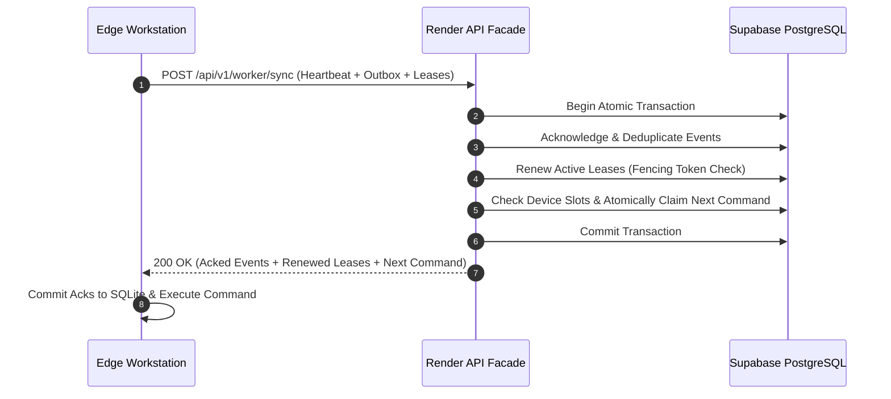
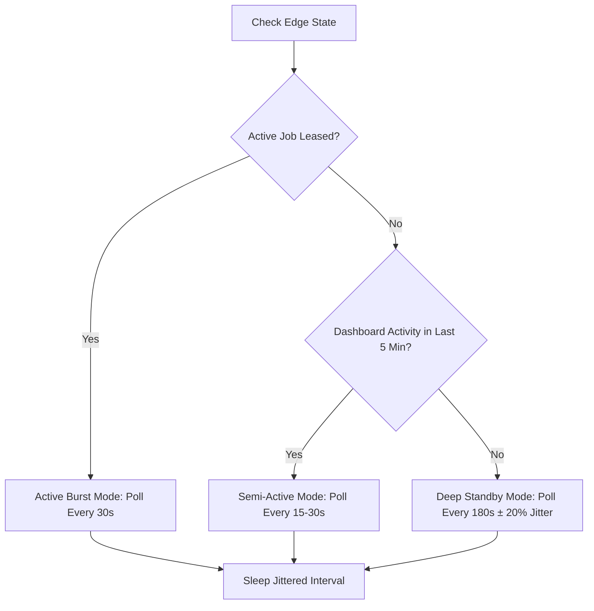

# 05 — API Specification & Worker Sync Protocol

## 1. REST API Interface Conventions

The Cloud Control Plane exposes versioned, strictly typed REST endpoints over HTTPS:
- **Base URL:** `https://api.yourstudio.com/api/v1`
- **Data Format:** JSON UTF-8
- **Authentication:**
  - **Browser Users:** Short-lived Supabase Access JWT passed via `Authorization: Bearer <jwt>` or HTTP-only session cookie.
  - **Edge Workers:** 256-bit cryptographically random device bearer token passed via `X-Worker-Token` header, validated using constant-time `hmac.compare_digest`.
- **Payload Limits:** Strict 64 KiB request default; 256 KiB sync batch limit; zero multi-part file uploads accepted on the Render API.
- **Idempotency:** All mutating requests from browsers accept an `Idempotency-Key` header with server-side body-hash deduplication.

---

## 2. Browser & Studio API Endpoints

| Method & Route | Access Level | Description |
|---|---|---|
| `GET /me` | Authenticated User | Retrieves user profile, active workspace, role, and current quota consumption. |
| `GET /devices` | Workspace Member | Lists paired edge workstations, online status, `last_seen`, and GPU capabilities. |
| `POST /devices/pair/approve` | Workspace Admin | Approves a 6-digit edge pairing code, binding the physical workstation to the workspace. |
| `POST /devices/{id}/revoke` | Workspace Admin | Instantly revokes a workstation's credentials, terminating all lease claims. |
| `POST /projects` | Editor / Admin | Creates a new clipping project with rights attestation and target video source. |
| `POST /projects/{id}/jobs` | Editor / Admin | Queues an `ANALYZE` or `RENDER` job with resource profile limits. |
| `GET /projects/{id}` | Viewer / Member | Retrieves candidate highlights, transcript snippets, and project status. |
| `POST /revisions/{id}/previews` | Member | Requests creation of an on-demand 360p preview video (<3 MB). |
| `GET /previews/{id}/url` | Member | Generates an expiring (15-minute) signed playback URL from Supabase Storage. |
| `POST /revisions/{id}/approvals` | Reviewer / Admin | **Human Release Gate:** Binds immutable approval to exact `artifact_sha256` and destinations. |
| `POST /approvals/{id}/publish` | Publisher / Admin | Queues dispatch intents for approved clips to YouTube, Instagram, or Facebook. |

---

## 3. The Master Edge Sync Protocol (`POST /worker/sync`)

The cornerstone of the outbound-only hybrid architecture is the **Unified Sync Call**. Rather than making multiple scattered API calls, the edge worker combines heartbeat, event acknowledgments, lease renewals, and command fetching into a **single transactional HTTP POST request**.



### 3.1 Worker Sync Request Payload
Sent by the edge worker on every sync loop:

```json
{
  "protocol_version": 1,
  "device_id": "dev_7c9f28a1-3b4e-4e6a-9b12-88f129a034bc",
  "cursor": "cursor_evt_1048",
  "capacity": {
    "heavy_slots_free": 1,
    "battery_state": "AC_POWER",
    "network_mode": "unmetered",
    "free_disk_gb": 48.5
  },
  "heartbeat": {
    "worker_version": "3.0.0",
    "uptime_seconds": 18420,
    "active_job_id": "job_98fa7c12"
  },
  "leases": [
    {
      "job_id": "job_98fa7c12",
      "fence": 14
    }
  ],
  "events": [
    {
      "event_id": "evt_01HXYZ9827",
      "job_id": "job_98fa7c12",
      "fence": 14,
      "seq": 22,
      "type": "STAGE_PROGRESS",
      "stage": "TRANSCRIBING",
      "progress_percent": 65,
      "message": "Whisper transcription 65% complete (chunk 13/20)"
    }
  ]
}
```

### 3.2 Server Sync Response Payload
Returned by the Render API coordinator:

```json
{
  "server_time": "2026-11-20T08:00:00Z",
  "cursor": "cursor_evt_1049",
  "acked_event_ids": [
    "evt_01HXYZ9827"
  ],
  "rejected_event_ids": [],
  "leases": [
    {
      "job_id": "job_98fa7c12",
      "fence": 14,
      "expires_at": "2026-11-20T08:02:00Z"
    }
  ],
  "commands": [
    {
      "command_id": "cmd_b1287c91",
      "type": "RENDER",
      "job_id": "job_a109fe23",
      "fence": 1,
      "expires_at": "2026-11-20T08:02:00Z",
      "payload": {
        "video_id": "dQw4w9WgXcQ",
        "clip_id": "dQw4w9WgXcQ_c1",
        "start_seconds": 212.5,
        "end_seconds": 257.0,
        "render_profile": {
          "layout_mode": "blur_background",
          "subtitle_preset": "hormozi",
          "fast_blur": true
        }
      }
    }
  ],
  "next_sync_seconds": 30,
  "policy_version": 3
}
```

---

## 4. Adaptive Polling Dynamics: Preserving the Free Tier

To guarantee that the Render free web service sleeps when idle and stays within the 750 free monthly instance-hour allowance, the worker adapts its polling frequency dynamically:



| Operating State | Polling Cadence | Purpose & Behavior |
|---|---|---|
| **Deep Standby (Queue Empty)** | **180 seconds** (120–240s with ±20% jitter) | Allows Render web service to sleep. Minimizes bandwidth to <3 MB/day. |
| **Active Burst (Job Running)** | **30 seconds** (fixed) | Streams stage progress, heartbeat, and renews 120s database lease. |
| **Interactive Studio (User Active)** | **15 seconds** (for 5 minutes) | Detected when user navigates web studio; provides snappier job pickup. |
| **Network Backoff (Error / Offline)** | **Exponential: 2s, 4s, 8s ... up to 300s** | Prevents hammering API during cloud outages or Render cold starts. |

---

## 5. Cold Start & Wakeup Handling

When Render puts the free API web service to sleep, the next incoming HTTP request triggers a container cold start:
- **Cold Wakeup Latency:** 30 to 50 seconds.
- **Worker HTTP Timeouts:**
  - `Connect Timeout:` **10.0 seconds** (detects dead network).
  - `Read Timeout:` **75.0 seconds** (allows sleeping Render instance to finish booting without aborting).
- **Graceful Retries:** The worker treats 502 Bad Gateway and 503 Service Unavailable responses during cold wake-up as transient, backing off smoothly rather than crashing.
