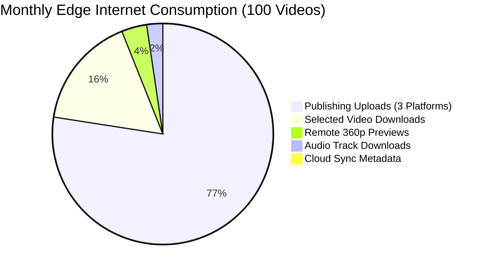

# 06 — Bandwidth Accounting, Network Governor & Preview Policy

## 1. The Zero-Cloud-Relay Network Strategy

A primary failure mode of naive cloud clipping platforms is routing multi-gigabyte raw video files through cloud API servers, leading to **gigantic bandwidth egress bills** and memory exhaustion.

Architecture V3 establishes a strict **Zero-Cloud-Relay Policy**:
- **Raw Video Bytes:** Streamed directly from authorized sources to the local edge workstation. Never touch Render or Supabase.
- **Rendered High-Bitrate Media:** Uploaded directly from the workstation's residential connection to social platforms. Never passes through Render.
- **Cloud Control Plane Traffic:** Restricted to lightweight JSON metadata (KB scale, not GB scale).

```
[Authorized Source] ──────────── Raw Media Bytes ───────────► [Edge Workstation]
                                                                     │
                                                                     ├─ Direct Upload
                                                                     ▼
[Cloud Control Plane] ◄───── Metadata Only (KB) ────► [YouTube / IG / FB]
```

---

## 2. Traffic Routing Matrix

| Communication Path | Protocol & Payload | Media Bytes Involved? | Provider Usage Boundary |
|---|---|---|---|
| **Browser -> Render Static** | HTTPS GET (HTML/JS/CSS) | No (Assets only) | Render outbound bandwidth (<250 KB first load) |
| **Browser <-> Render API** | HTTPS JSON (REST endpoints) | No | Render request/response bandwidth (<5 KB/call) |
| **Edge <-> Render API** | HTTPS POST `/worker/sync` | No | Render bandwidth (~3 KB response/sync) |
| **Source -> Edge Worker** | HTTPS GET (Audio/Video chunks) | **Yes (Direct)** | User's home ISP download |
| **Edge -> Supabase Storage** | HTTPS PUT (360p Preview Video) | **Optional (<3 MB)** | Supabase storage capacity (1 GB free) |
| **Supabase -> Browser** | HTTPS GET (Signed playback URL) | **Optional (<3 MB)** | Supabase egress (5 GB/month free) |
| **Edge -> Social Platforms** | HTTPS POST/PUT (Resumable upload) | **Yes (Direct)** | User's home ISP upload; Zero cloud bandwidth |

---

## 3. The Worked Monthly Bandwidth Budget (100 Source Videos)

To prove that the platform operates permanently within free-tier limits, consider an intense production workload:
- **100 long-form source videos** processed per month.
- **3 viral clips** generated per source video (total 300 Short clips).
- **45 seconds** average duration per Short.
- **1080x1920 @ 30fps** master export (3.0 Mbps video + 128 kbps audio).



### Detailed Monthly Accounting Table

| Operation Flow | Data Size Per Video | Monthly Total (100 Sources) | Free-Tier Capacity | Margin of Safety |
|---|---|---|---|---|
| **Audio-First Downloads** | 4.8 MB (mono audio) | **0.48 GB** (Edge Download) | Unlimited (Home ISP) | Safe |
| **Selected Video Downloads** | 33.75 MB (3 x 45s chunks) | **3.375 GB** (Edge Download) | Unlimited (Home ISP) | Safe |
| *Full Source Fallback (if range fails)* | *150 MB (10-min video)* | *15.0 GB (Edge Download)* | *Unlimited (Home ISP)* | *Manageable* |
| **Master Renders (Local SSD)** | 52.8 MB (3 x 1080p clips) | **5.28 GB** (Local Disk) | Local NVMe SSD | Safe |
| **Social Uploads (3 Platforms)** | 158.4 MB (3 clips x 3 platforms)| **15.84 GB** (Edge Upload) | Unlimited (Home ISP) | Safe |
| **Optional 360p Cloud Previews** | 7.56 MB (3 x 2.5 MB proxy) | **0.756 GB** (Supabase Storage)| 1.0 GB Free Storage | 24% Headroom |
| **Remote Preview Streaming** | 15.12 MB (2 plays / clip) | **1.512 GB** (Supabase Egress) | 5.0 GB Free Egress | 70% Headroom |
| **Render API Control Sync** | ~720 KB (daily syncs) | **0.072 GB** (Render Bandwidth) | 5.0 GB Free Bandwidth| 98.5% Headroom |

---

## 4. The Network Governor & Token-Bucket Byte Pacing

To prevent pipeline downloads and uploads from saturating the user's home network, the edge engine includes an embedded **Network Governor**:

```python
class NetworkGovernor:
    """
    Applies token-bucket pacing and rolling EWMA throughput estimates
    to ensure background video processing never disrupts gaming or calls.
    """
    def __init__(self, profile: str = "balanced"):
        self.download_limit_bytes = 512 * 1024  # 512 KB/s (Balanced)
        self.upload_limit_bytes = 256 * 1024    # 256 KB/s (Balanced)
        self.active_streams = 0
```

### Bandwidth Profiles

| Governor Profile | Max Bulk Download | Max Bulk Upload | Target Environment |
|---|---|---|---|
| **Metered / Eco** | 128 KiB/s (~1.0 Mbps) | 64 KiB/s (~0.5 Mbps) | Mobile hotspots, capped 4G/5G connections |
| **Balanced (Default)** | 512 KiB/s (~4.2 Mbps) | 256 KiB/s (~2.1 Mbps) | Standard residential broadband (50–100 Mbps) |
| **Unrestricted** | Host Max | Host Max | Dedicated studio fiber connections (100+ Mbps) |

---

## 5. Remote Preview Policy: Metadata-First Architecture

### 5.1 The Principle: Review Content, Not Just Pixels
In 90% of editorial review sessions, reviewers only need to check:
1. Did the hook pick the right quote?
2. Are the generated titles and captions punchy and accurate?
3. Does the detected face stay framed properly?

Architecture V3 defaults to a **Metadata-First Review Mode**:
- The web studio immediately renders the candidate transcript, word-level subtitle timings, scoring rationale, and a **high-resolution WebP poster image (30 KB)**.
- Reviewers can scrub word-by-word through the transcript on their phones without downloading a single video byte!

### 5.2 On-Demand 360p Preview Proxies
When full-motion video review is explicitly requested:
1. The edge worker renders an ultra-efficient 360p proxy:
   - **Resolution:** 360×640 (9:16 vertical).
   - **Framerate:** 24 fps.
   - **Bitrate:** 400 kbps H.264 video + 48 kbps AAC audio.
   - **File Size:** **~2.5 MB** for a 45-second Short.
2. The proxy is uploaded directly to a private Supabase Storage bucket via a temporary signed URL.
3. The cloud API issues a short-lived (15-minute) signed playback URL to the reviewer's phone player.
4. **Automated Lifecycle Expiration:** An automated cron prunes preview objects older than 72 hours, guaranteeing cloud storage never exceeds free tier limits.
