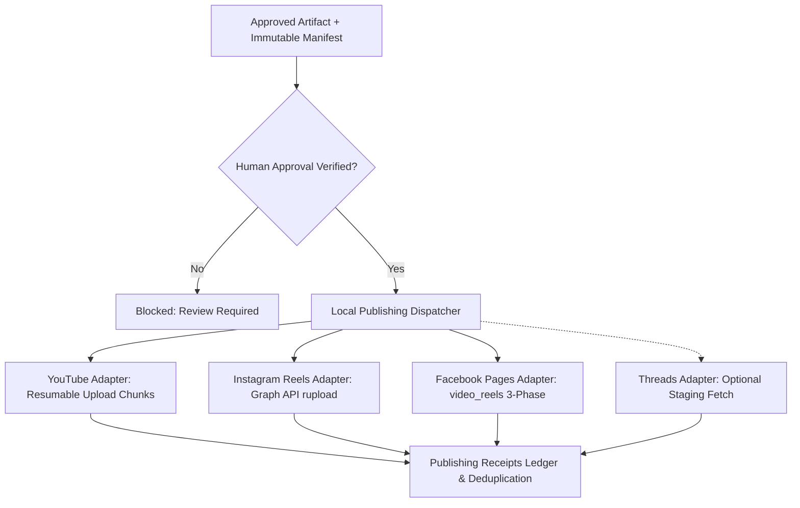

# 07 — Social Publishing Adapters & Residential Dispatch Engine

## 1. The Residential IP Publishing Advantage

Cloud datacenter IPs (AWS, Render, GCP, DigitalOcean) are widely flagged by social media platforms (Meta, Google, TikTok) as automated scraping or spam vectors, often causing instant account suspensions or CAPTCHA challenges.

By executing social uploads **directly from the user's home workstation**:
- Media bytes originate from a legitimate, residential ISP IP address.
- Traffic behaves identically to a creator manually uploading via desktop browser or phone.
- **Fail-Closed Credential Security:** Long-lived publishing refresh tokens remain stored exclusively on the user's local machine inside the OS Credential Vault. They are **never** transmitted to or stored on cloud servers.

---

## 2. Platform Adapter Specifications



### 2.1 YouTube Data API v3 Adapter
- **Endpoint:** `POST https://www.googleapis.com/upload/youtube/v3/videos?uploadType=resumable&part=snippet,status`
- **Protocol:** Google Resumable Upload protocol.
- **Chunk Size:** 1 MiB aligned byte chunks (must be multiples of 256 KiB).
- **Shorts Auto-Detection:** Vertical 9:16 aspect ratio + duration $\le 60$ seconds is automatically categorized as a Short by YouTube.
- **Default Privacy:** Posts default to `private` or `unlisted` for operator safety until explicitly approved for public launch.
- **Authentication:** Desktop OAuth 2.0 with PKCE running locally on loopback.

### 2.2 Instagram Reels Adapter (Professional Accounts)
- **Eligibility:** Business or Creator accounts connected to a Facebook Page.
- **Flow:**
  1. `POST /{ig-user-id}/media` with `media_type=REELS` and `upload_type=resumable`. Returns an upload session URI.
  2. Stream video bytes via `POST` to `rupload.facebook.com` with `offset` and `file_size` headers.
  3. Poll `GET /{container-id}?fields=status_code` until status reaches `FINISHED`.
  4. `POST /{ig-user-id}/media_publish` with `creation_id` to release the Reel publicly.

### 2.3 Facebook Pages Adapter (Page Video Reels)
- **Target:** Authorized Facebook Page (not personal timelines).
- **3-Phase Flow:**
  1. **Phase 1 (Start):** `POST /{page-id}/video_reels` with `upload_phase=start`. Returns `video_id` and upload URL.
  2. **Phase 2 (Transfer):** Stream binary bytes to `rupload.facebook.com/video-upload/...`.
  3. **Phase 3 (Finish):** `POST /{page-id}/video_reels` with `upload_phase=finish`, setting title, description, and `video_state=PUBLISHED`.

### 2.4 Threads Adapter (Optional & Staged)
- Unlike YouTube or Meta Reels, the standard Threads API does **not** accept direct binary file streaming from a local machine; it requires a publicly accessible `video_url`.
- **Staging Pipeline:** The edge worker uploads the approved master render to a private Supabase bucket and generates an expiring (1-hour) signed URL accessible by Meta's crawlers.
- Meta fetches the video from Supabase, processes it, and publishes the thread container. Once published, the staging video is immediately purged from Supabase to preserve storage.

---

## 3. Split OAuth Architecture: Desktop PKCE vs Hosted Broker

| Platform | OAuth Flow Used | Why This Flow? | Token Storage Location |
|---|---|---|---|
| **YouTube** | **Native Desktop PKCE** (`127.0.0.1` Loopback) | Google allows local loopback redirects for installed desktop apps. Keeps client secrets off the internet. | Windows Credential Manager (`win32cred`) on workstation |
| **Meta (IG/FB)** | **Hosted Web OAuth Broker** (Render Callback) | Meta requires exact HTTPS redirect URIs and confidential app secrets. Render acts as secure broker, then encrypts token directly to workstation's public key. | Windows Credential Manager (`win32cred`) on workstation |

---

## 4. The Human Release Gate & Irreversible Action Guard

### 4.1 Strict Two-Stage Lifecycle
```
[Stage A: Render & QA] 
       │
       ▼
[Status: REVIEW_REQUIRED] ◄── Operator reviews in Cloud Studio
       │
       ├─ Operator Clicks "Approve & Publish"
       ▼
[Stage B: Publish Intent]
       │
       ▼
[Edge Worker Claims Publish Task & Dispatches via Residential IP]
```

### 4.2 The `RECONCILE_REQUIRED` Guardrail (Zero Blind Retries)
The most dangerous failure mode in automated social publishers is a **network timeout during the final publish request**:
- The platform may have successfully published the video, but the response packet was lost.
- If the worker blindly retries, it posts an accidental **duplicate video**, annoying viewers and harming channel analytics.

**The Architecture V3 Rule:**
1. If an upload or publish request times out or disconnects after bytes were transferred, the job state enters `RECONCILE_REQUIRED`.
2. The worker is **strictly forbidden** from re-uploading bytes.
3. The worker must query the platform's status endpoint (e.g. `GET /{container-id}` or `videos.list(id)`) to check if the asset was processed.
4. Only if the platform confirms the session was completely lost and no post exists can the user authorize a fresh retry.

---

## 5. Repository Quirk 3 Resolution: Standardizing OmniPost on Port 3300

In the existing codebase:
- `src/yt_clipping/publisher/omnipost.py:44` defaults to `http://localhost:3300`.
- `frontend/next.config.mjs:9` was defaulting `OMNIPOST_URL` to `http://127.0.0.1:3000`.

**The Standardization Fix:**
All configurations, Next.js rewrites, and environment templates are standardized to **Port 3300**:
```javascript
// frontend/next.config.mjs
const OMNIPOST_URL = process.env.OMNIPOST_BACKEND_URL || 'http://127.0.0.1:3300';
```
This ensures social publishing requests proxy seamlessly from the Next.js Studio to the OmniPost publishing daemon.
