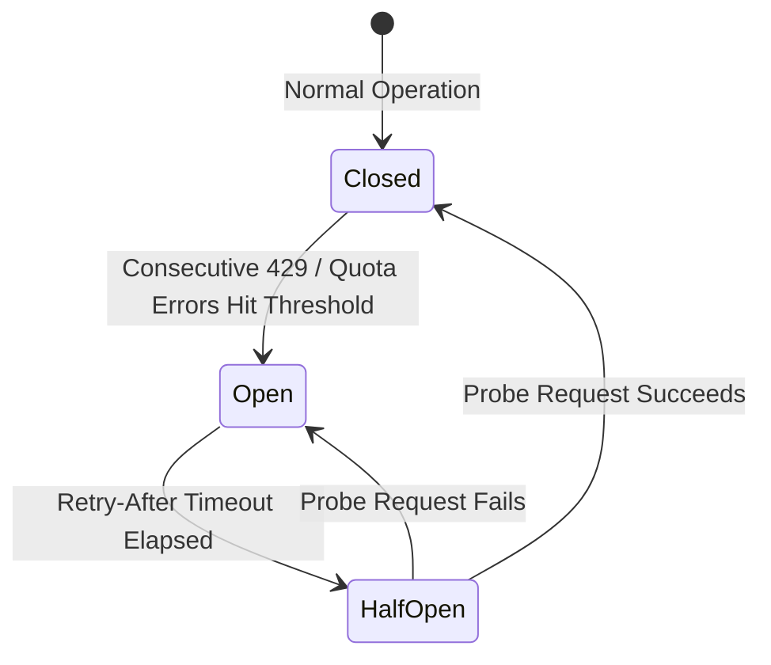

# 08 — Security, Quotas & Circuit Breaker Architecture

## 1. Layered Defense-in-Depth Request Admission

To protect the lightweight Cloud Control Plane (512 MB RAM instance) from denial-of-service, runaway compute, or credential stuffing, incoming requests must pass through a **hierarchical admission pipeline**:

```
[Incoming HTTP Request]
         │
         ├─► Layer 1: IP Rate & Burst Limiting (In-memory token bucket; 30 req/min/IP)
         │
         ├─► Layer 2: Protocol & Payload Inspection (Max 64 KiB body cap; strict JSON)
         │
         ├─► Layer 3: Identity Verification (Supabase JWT / 256-bit X-Worker-Token)
         │
         ├─► Layer 4: Workspace Authorization & RLS (Tenancy isolation via PostgreSQL)
         │
         ├─► Layer 5: Idempotency & Replay Shield (Deduplication against API idempotency keys)
         │
         ├─► Layer 6: Durable Quota Reservation (PostgreSQL atomic counter check)
         │
         ▼
[Execute Controller Action / Database Mutation]
```

---

## 2. In-Memory Token Bucket vs PostgreSQL Durable Counters

| Aspect | Layer 1: In-Memory Token Bucket | Layer 6: PostgreSQL Durable Counters |
|---|---|---|
| **Storage Location** | FastAPI process memory (`asyncio` dict) | PostgreSQL table `private.quota_counters` |
| **Purpose** | Coarse pre-auth shielding against volumetric spam | Authoritative, tamper-proof billing and daily usage limits |
| **Persistence** | Resets on server restart or container scale | Survives server restarts, redeployments, and crashes |
| **Enforcement Scope** | Per-instance IP rate limiting | Entire workspace / device / provider daily envelope |
| **Performance** | Sub-millisecond ($< 0.1\text{ ms}$) | Fast single-row indexed update ($< 2.0\text{ ms}$) |

---

## 3. Initial Application Policy Limits

These application defaults prevent accidental quota exhaustion on external APIs and cloud services:

| Operation Category | Limit | Enforcement Mechanism |
|---|---|---|
| **Unauthenticated API Calls** | 30 req / min / IP | In-memory token bucket with IP burst tolerance |
| **Worker Pairing Attempts** | 5 attempts / 10 min / IP | Hard lockout with cryptographic challenge |
| **Authenticated UI Reads** | 60 req / min / user | Token bucket per active Supabase JWT |
| **Job Creation** | 10 jobs / day / workspace | Durable counter in PostgreSQL; max 20 queued |
| **Worker Sync Polls** | 12 req / min / device (burst 5) | Verified `X-Worker-Token` bearer authentication |
| **Video Discovery Searches** | 20 upstream calls / day / workspace | 30-minute PostgreSQL query caching |
| **Gemini AI Refinements** | 10 calls / day / workspace | Opt-in; max 1 call / job; token capped |
| **Remote 360p Previews** | 10 previews / day / workspace | Bounded to 3 previews / clip; max 4 MiB / object |
| **Social Publish Intents** | 10 posts / day / workspace | 1 active upload per account; idempotency key |

---

## 4. Provider Circuit Breakers & Retry Policies

When communicating with external APIs (YouTube, Meta, Gemini), client adapters wrap every request in a **Resilient Circuit Breaker**:



### Response Status Handling Matrix

| HTTP Status / Condition | Root Cause | Circuit Breaker Action |
|---|---|---|
| **`429 Too Many Requests`** | API quota or rate limit exceeded | Open circuit immediately. Read `Retry-After` header. Defer all pending jobs until provider reset time. |
| **`401 Unauthorized`** | Expired access token | Execute one synchronized token refresh using local refresh token. Retry original request once. If refresh fails, mark account `DISCONNECTED`. |
| **`403 Forbidden`** | Scope mismatch, copyright strike, or missing permissions | Fail closed. **Do not retry.** Alert user with actionable explanation (e.g. "Missing pages_manage_posts permission"). |
| **`5xx Server Error / Network Drop`** | Transient cloud failure | Exponential backoff with jitter: $T = 2^a \times (1 \pm 0.2)\text{ seconds}$. Max 3 retries for safe calls; 1 for AI calls. |
| **Upload Timeout (Uncertain Publish)** | Network dropped during final byte push | **Zero Blind Retries.** Enter `RECONCILE_REQUIRED` state. Query existing session/container status before any further action. |

---

## 5. Threat Model & Mitigation Matrix

| Security Threat | Attack Vector | Architecture V3 Mitigation |
|---|---|---|
| **Cross-Tenant IDOR** | Malicious user queries another workspace's project ID | PostgreSQL Row-Level Security (RLS) + transaction-scoped `workspace_id` validation. |
| **Social Credential Theft** | Attacker compromises cloud server and steals tokens | Social OAuth refresh tokens reside **exclusively** on the local workstation inside Windows Credential Manager. Zero tokens in the cloud. |
| **Command Injection** | Malicious command injected into worker queue | Worker only executes strict enum commands (`ANALYZE`, `RENDER`, `PUBLISH`). No raw shell execution or dynamic Python imports. |
| **SSRF & Metadata Leakage** | Attacker feeds URL pointing to `169.254.169.254` or `127.0.0.1` | Embedded SSRF Validator resolves DNS, verifies public routability, and strictly blocks private RFC1918 / loopback / link-local addresses. |
| **Malicious Video Exploits** | Corrupted MP4 designed to exploit FFmpeg decoders | FFmpeg executes inside a sandboxed child process with hard memory limits, time deadlines, and disabled network access (`-nostdin`). |
| **Prompt Injection** | Video title contains instructions to override LLM | Transcripts and titles are treated as inert string data in JSON structures. LLM outputs are schema-validated; cannot execute tools. |
| **Replay / Stale Overwrite** | Disconnected worker attempts to overwrite newer edit | Monotonic fencing tokens (`fence`). Stale writes rejected with `409 LEASE_STALE`. |
