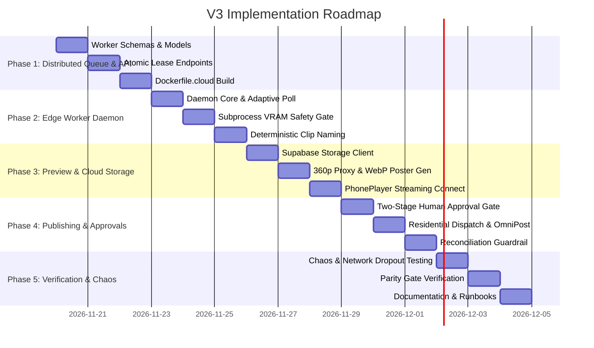

# 09 — Architectural Improvisations & Codebase Bridge Plan

## 1. Executive Context

The V3 specification (`YT_Clipper_Architecture_V3.md`) provides an exceptional, battle-hardened blueprint. To make it maximally effective for **`yt-clipping-intelligence`**, this document outlines **5 high-impact engineering improvisations** and a concrete **codebase bridge strategy** that connects the specification directly to our existing codebase without breaking existing functionality.

---

## 2. Five Key Architectural Improvisations

### Improvisation 1: Unified Database Repository with Dual Dialect (SQLite <-> PostgreSQL)
- **The Challenge:** The codebase currently uses SQLite via `DatabaseManager` (`src/yt_clipping/orchestration/db.py`) and `JobManager` (`src/yt_clipping/orchestration/job_manager.py`). V3 calls for PostgreSQL on Supabase in connected mode, but SQLite on the edge in standalone mode.
- **The Improvisation:** Rather than maintaining two completely separate codebases, implement a **Dual-Dialect Storage Repository Pattern**:
  - `DatabaseBackend` abstract base class defining `claim_next_job`, `renew_lease`, `record_event`, and `reconcile_state`.
  - `SQLiteBackend`: Uses `BEGIN IMMEDIATE` and `datetime('now')` with WAL mode.
  - `PostgresBackend`: Uses `FOR UPDATE SKIP LOCKED` and `now()`.
  - Both backends share identical typed data contracts from `src/yt_clipping/contracts/models.py`.

### Improvisation 2: Deterministic Clip Keying & Multi-Clip Checkpoint Resumption
- **The Challenge:** In `pipeline.py:878`, clip job IDs are currently generated with random UUID suffixes: `clip_job_id = f"job-{video_id}-c{idx}-{uuid.uuid4().hex[:6]}"`. If a machine crashes while rendering Clip 3 of 3, restarting the job generates new random UUIDs, forcing the pipeline to re-download, re-transcribe, and re-render Clips 1 and 2 from scratch.
- **The Improvisation:** Standardize clip naming deterministically:
  - Canonical Clip ID: `{video_id}_c{idx}` (e.g. `dQw4w9WgXcQ_c1`, `dQw4w9WgXcQ_c2`).
  - Canonical Output Path: `data/rendered_clips/{video_id}_c{idx}.mp4`.
  - Canonical Checkpoint Key: `data/checkpoints/{video_id}_c{idx}.checkpoint.json`.
  - **Resume Logic:** Before starting render for candidate `c{idx}`, the worker inspects disk: if `{video_id}_c{idx}.mp4` exists, verifies its SHA-256 against manifest, and runs QA validation. If valid, it **skips re-rendering instantly**, saving minutes of GPU time!

### Improvisation 3: SQLite Outbox for Zero-Loss Offline Telemetry
- **The Challenge:** If the edge worker loses internet while rendering, progress logs and completion receipts could be lost or cause network exceptions that crash the pipeline.
- **The Improvisation:** Implement a local **SQLite Event Outbox**:
  ```sql
  CREATE TABLE local_outbox (
      event_id TEXT PRIMARY KEY,
      event_type TEXT NOT NULL,
      job_id TEXT NOT NULL,
      fence INTEGER NOT NULL,
      payload_json TEXT NOT NULL,
      created_at TEXT NOT NULL,
      acked_at TEXT
  );
  ```
  - When a stage completes, the checkpoint and the outbox event (`STAGE_COMPLETED`) are committed in the **same local SQLite transaction**.
  - The worker sync loop drains unacknowledged events from `local_outbox` during the next sync call.
  - Guarantees **100% at-least-once delivery** of all stage milestones with zero lost state across network drops.

### Improvisation 4: Dual-Engine Preview Hierarchy (Local Video -> 360p Proxy -> Interactive Transcript)
- **The Challenge:** Streaming full-motion video from Supabase Storage consumes egress bandwidth (5 GB free limit).
- **The Improvisation:** The Next.js Studio `PhonePlayer` adapts its playback source based on client context:
  1. **Tier 1 (Local Studio on 127.0.0.1):** Streams the master 1080p MP4 directly from local disk via loopback HTTP (`/clips/{clip_id}.mp4`). Consumes 0 KB cloud bandwidth.
  2. **Tier 2 (Remote Cloud Studio with Preview):** Streams the 360p proxy video (<2.5 MB) via signed URL from Supabase Storage.
  3. **Tier 3 (Zero-Bandwidth Fallback / Metered Mode):** If cloud egress budget hits 80%, the player seamlessly switches to **Interactive Transcript Mode**: displays the high-res 30 KB WebP poster, plays the audio track (or synthesized speech), and animates word-by-word highlighted captions synchronized to time!

### Improvisation 5: OmniPost Residential Gateway Integration
- **The Challenge:** Managing OAuth for four different social platforms directly in raw Python scripts can lead to code bloat and maintenance headaches.
- **The Improvisation:** Leverage the repository's existing `OmniPostPublisher` (`src/yt_clipping/publisher/omnipost.py`), standardized on port `3300`:
  - OmniPost runs as a local sidecar on the workstation.
  - The edge worker dispatches approved publishing payloads to `http://localhost:3300/api/v1/publish`.
  - OmniPost handles multi-platform rate-limiting, token rotation, and residential IP dispatch.
  - All publishing receipts are logged back into SQLite and synced to the cloud plane.

---

## 3. Concrete Codebase Bridge Matrix

| Existing Module | Current Status | Architecture V3 Upgrade Bridge |
|---|---|---|
| `src/yt_clipping/contracts/models.py` | Rich data contracts (`ClipJob`, `HighlightCandidate`, `RenderProfile`) | Add worker contracts: `WorkerClaimRequest`, `WorkerHeartbeat`, `WorkerProgress`, `WorkerCompletePayload`. |
| `src/yt_clipping/orchestration/job_manager.py` | Single-machine SQLite `render_jobs` table | Add distributed lease fields: `worker_id`, `fence`, `lease_expires_at`. Fix Quirk 1 (server restart lease recovery). |
| `src/yt_clipping/orchestration/pipeline.py` | Monolithic `process_video_multi` | Fix Quirk 2 (deterministic `{video_id}_c{idx}` clip IDs). Add isolated subprocess calls for ASR and VRAM release. |
| `src/yt_clipping/web/server.py` | Unified FastAPI studio + local background runner | Add worker API endpoints (`/api/v1/worker/claim`, `/heartbeat`, `/progress`, `/complete`). Expose `X-Worker-Token` auth. |
| `src/yt_clipping/transcription/transcriber.py` | `release_whisper_models()` defined | Integrate with ASR subprocess runner to guarantee 100% CTranslate2 CUDA VRAM reclamation. |
| `src/yt_clipping/rendering/encoder_config.py` | Hardware NVENC & CPU fallback detection | Already production-grade; integrate directly with single-pass vertical crop filtergraph. |
| `src/yt_clipping/publisher/omnipost.py` | Unified social publisher on port 3300 | Fix Quirk 3 (`next.config.mjs` port 3300 standardization). Wrap publishing in two-stage human approval gate. |
| `frontend/next.config.mjs` | SSR config with API rewrites | Add Static Export config (`output: 'export'`) for Render Static Site deployment while keeping rewrites for local dev. |
| `frontend/src/components/studio/phone-player.tsx` | Interactive 9:16 smartphone player | Support remote signed URLs and Fallback Interactive Transcript scrubbing mode. |

---

## 4. Phase-by-Phase Roadmap



### Phase Summary:
1. **Phase 1: Distributed Job Queue & Cloud Worker API**
   - Update models with `WorkerClaimRequest`, `WorkerHeartbeat`, `WorkerProgress`, and `WorkerCompletePayload`.
   - Implement row-level lease endpoints in `server.py` and `job_manager.py`.
   - Build ultra-lean `Dockerfile.cloud` (<120 MB RAM).
2. **Phase 2: Edge Worker Daemon Core (`src/yt_clipping/worker/daemon.py`)**
   - Build autonomous background daemon with adaptive polling (180s idle / 30s active).
   - Implement isolated subprocess ASR for CTranslate2 VRAM safety.
   - Enforce deterministic clip naming (`{video_id}_c{idx}`) and checkpoint resumption.
3. **Phase 3: Cloud Storage & Preview Integration**
   - Implement Supabase Storage client for on-demand 360p proxies (<2.5 MB).
   - Connect Next.js `PhonePlayer` to stream signed URLs with 72-hour automated retention.
4. **Phase 4: Two-Stage Lifecycle & Residential Social Publishing**
   - Enforce `REVIEW_REQUIRED` -> `APPROVED` -> `PUBLISHED` lifecycle.
   - Wire local OmniPost (`:3300`) and YouTube OAuth via residential ISP.
   - Implement `RECONCILE_REQUIRED` zero-blind-retry guard.
5. **Phase 5: Verification, Chaos Testing & Operational Runbooks**
   - Simulate network dropouts, mid-render kills, and server restarts.
   - Verify scratch disk cleanup.
   - Update `.env.example` and `README.md`.
